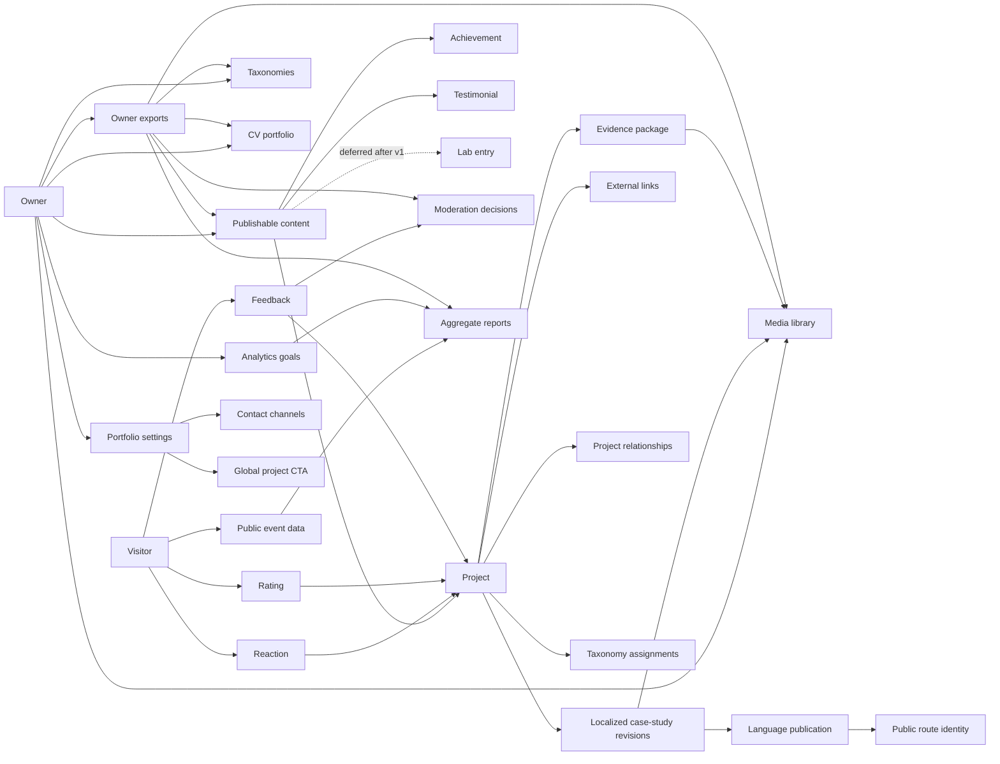
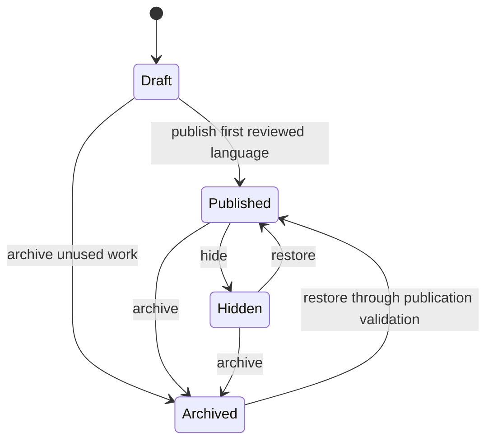

# ShipWithAli Domain Model

## Purpose and authority

This document is the implementation-neutral behavioral model for ShipWithAli. It translates the shared language in [`CONTEXT.md`](../CONTEXT.md) and the accepted records in [`docs/adr/`](./adr/) into identities, relationships, invariants, state transitions, commands, and observable domain events.

When documents disagree, accepted ADRs take precedence over the product brief. `CONTEXT.md` remains the authority for vocabulary; this document defines how those concepts relate and behave. It deliberately does not prescribe database tables, framework types, hosting providers, or API wire formats.

## Release boundary

The long-term model contains Projects, Lab entries, Achievements, Testimonials, portfolio settings, publishing, visitor interactions, measurement, and portability.

The first release includes:

- the English and Arabic public experiences;
- Projects, case studies, taxonomy-driven discovery, and owner-curated Project relationships;
- the Achievement Timeline, Testimonials, the Current CV, Contact channels, and the Global project CTA;
- owner-managed publishing, evidence checks, media acceptance, moderation, analytics, and export;
- durable public routes and resilient delivery of the Core public journey.

The first release excludes every Lab entry capability: no public route, navigation, publication workflow, visitor interaction, or owner-management surface may expose a Lab entry. Lab entry remains in the model so later work can activate it only after revisiting ADR-0007.

## Domain at a glance

Arrows show ownership or a domain reference, not a storage dependency. Cross-group references use stable identities and do not transfer ownership of the referenced concept.

## Identities and aggregate groups

An identity remains stable while names, labels, slugs, revisions, states, or providers change. A public URL is not the identity of its content.

| Aggregate group | Stable root identity | Owns | References | First release |
| --- | --- | --- | --- | --- |
| Portfolio settings | Portfolio identity | public profile, Contact channels, Global project CTA | accepted Media assets | Yes |
| Project | Project identity | Public lifecycle, Project status, Featured flag, Localized revision streams, Evidence package, External links, taxonomy assignments | Media assets, Taxonomy values, other Projects | Yes |
| Achievement | Achievement identity | Public lifecycle, Localized revision streams, Evidence package, Timeline date | Media assets | Yes |
| Testimonial | Testimonial identity | name, quote, association, Public lifecycle, Localized revision streams, publication history | zero or one Project | Yes |
| Lab entry | Lab entry identity | Public lifecycle, Localized revision streams, evidence, links, media references | Media assets, Taxonomy values | No; model only |
| Taxonomy | Taxonomy identity | name, purpose, Taxonomy values, evolution history | nothing outside the aggregate | Yes |
| Media library | Media asset identity | safety assessment, accessibility metadata, acceptance and publication history | owning portfolio identity | Yes |
| Feedback | Feedback identity | submitted name and paragraph, current presentation eligibility, Moderation decisions | one Project; no persistent Visitor identity | Yes |
| CV portfolio | CV portfolio identity | CV versions and the Current CV designation | accepted file assets | Yes |
| Analytics goal | Analytics goal identity | ordered goal versions and current active version | known public actions, pages, and Project identities | Yes |
| Measurement | Public event identity while detail is retained | privacy-minimized event facts, Journey context, aggregates | Visitor measurement identity, public content identities | Yes |
| Owner export | Export identity | export scope, schema version, creation record, integrity manifest | portable snapshots of included domain records | Yes |

### Relationship rules

- One Project has one stream for each supported language it has begun authoring. In the first release, supported languages are English and Arabic.
- One Localized revision stream has one or more Revisions and zero or one current published Revision.
- A Revision belongs to exactly one stream and never moves to another Project, content type, or language.
- A Project may have many Taxonomy values. Every assignment points to a value in the appropriate Taxonomy.
- A Project relationship joins two distinct Projects. It makes them eligible for related-project presentation only while both have a public Language version for the visitor's locale.
- A Testimonial belongs either to the general profile or to exactly one Project.
- An External link belongs to one Project. A Contact channel belongs to portfolio settings; the two concepts are not interchangeable.
- A Reaction and a Rating each belong to one Project and one purpose-limited FunctionalVisitor identity. Only one current value of each kind may exist for that pair.
- Feedback belongs to one Project. Public display additionally depends on both Feedback approval and Project visibility.
- A CV version belongs to the single CV portfolio. Exactly one accepted English CV version is Current CV once CV access is launched.

## Publishing model

### Content-wide lifecycle

Public lifecycle is content-wide. It controls whether any language route can be publicly discovered.

- Saving a Revision never changes Public lifecycle.
- Draft has no publicly reachable Language version.
- Published is the only discoverable state. It still exposes only locales with a current published Revision.
- Hidden is a reversible removal from public discovery. Its current published Revision pointers, route history, interaction history, and measurements remain retained.
- Archived marks retained historical content. It is removed from public discovery and normal public presentation without erasing its revisions, evidence, interactions, or measurements.
- Restoring Hidden or Archived content must pass current publication validation before it returns to Published.
- Featured and Project status never change Public lifecycle. Featuring non-Published content has no public effect.

### Language publication

- English and Arabic use independent Localized revision streams.
- Publishing a Revision affects only its own language. It never publishes, modifies, or exposes another stream.
- Public localized text never falls back to text from another language. A locale without a current published Revision has no public content route for that item.
- The Arabic experience may reference an accepted English Media asset, because media reuse is not text publication.
- In the first release, CV access and External links remain English-only. Arabic presentation must state unavailability truthfully instead of labeling an English destination as localized.
- Publishing a newer Revision moves that stream's current-public designation atomically. The former Revision remains in history.
- While a new Revision is being prepared, the stream's last valid published Revision remains public.

### Publication validation

A publication or restoration succeeds only when all applicable rules pass:

- the target Revision exists, belongs to the requested content and language, and has been explicitly reviewed;
- required case-study content is present for a Project;
- the Evidence package passes its content-type rules and contains no unsupported metric or fabricated placeholder;
- every referenced public Media asset is safe, accepted, and has the required Media accessibility metadata;
- public labels and External links truthfully represent destination availability;
- a new or changed slug can be attached to the existing Public route identity without conflicting with another identity;
- the requested operation does not expose a Lab entry during the first release.

Failure leaves the existing Public lifecycle, current published Revision, canonical route, and public read state unchanged. Notifications and analytics are never prerequisites for successful publication.

### Evidence rules by content type

| Content type | Publication evidence rule |
| --- | --- |
| Project | Requires a complete minimum case study and an accepted Evidence package containing Supporting artifacts for its material claims and outcomes. |
| Achievement | Requires Supporting artifacts or a recorded internal owner verification when public proof is inappropriate or unavailable. |
| Testimonial | Requires a stored name and quote only; no permission or relationship-verification record is required. Public presentation must not imply stronger provenance. |
| Lab entry | May present incomplete work when honestly labeled, but is excluded from first-release publication. |
| Media asset | Requires safe processing, acceptance, and appropriate accessibility metadata before public use. |

Evidence state is internal editorial information. It must not be rendered as an external certification or verification badge.

### Durable routes and ordering

- A page receives one Public route identity on first successful publication.
- Changing a title or slug never creates a new content identity. The former route becomes a Public route redirect to the current canonical route.
- Draft previews are private and non-indexable and do not establish a public redirect contract.
- Public Project discovery is ordered by publication time, newest first. Manual ranking is not part of the domain.
- Featured may provide a separate editorial presentation, but it must not silently redefine the canonical newest-published ordering.

## Classification and relationships

- Taxonomies are controlled vocabularies; Projects cannot introduce private free-form substitutes for managed values.
- An active Taxonomy value may be assigned to new or existing Projects.
- Renaming changes its public label without replacing its stable identity or historical assignments.
- Retiring prevents new assignments while preserving existing ones.
- Merging explicitly migrates affected assignments to the surviving value and retains an auditable mapping from the retired value.
- Project status is a maturity or work-state classification, not Public lifecycle. `Archived` is therefore forbidden as a Project status.
- Project relationships are owner-curated associations, not automatically inferred recommendations. A relationship never makes an unpublished Project visible.

## Media and CV

### Media

- Uploading creates no public entitlement. A Media asset remains private until its type, safety, ownership, and public suitability are accepted.
- Meaningful images require an approved non-visual description; decorative images require an explicit decorative classification.
- Meaningful video requires the approved caption or summary appropriate to its public use.
- Acceptance snapshots the exact current processing evidence and outputs together with separate Owner attestations of ownership and public suitability; it does not replace scanner or processor evidence.
- Acceptance is a terminal decision for the current candidate. A different idempotency key cannot create a second acceptance or restart processing after that decision.
- Acceptance facts are read inside the caller's transaction and hold shared per-asset locks until it ends. Acceptance and processing commits take the corresponding exclusive lock, so a referencing decision cannot race with a facts read.
- A consistency version is an opaque, bounded token over the complete, sorted fact set, intended use, and current processing policy. Missing or foreign assets fail the batch closed.
- A decorative-only image can satisfy an explicitly decorative use, but cannot satisfy a supporting-artifact use that requires meaningful visual content.
- A Revision may reference a Media asset only by stable identity. Moving storage providers or regenerating variants does not change that identity.
- A public page must remain useful when rich media cannot load; media failure cannot block its core message or navigation.

### CV portfolio

- A file upload is only a candidate for a CV version; validation and acceptance precede activation.
- Activating a CV version atomically removes the Current CV designation from the previous version and assigns it to the replacement.
- The domain must never expose two Current CV versions or a partially accepted upload.
- Previous versions remain in owner history unless a governing Retention policy requires removal.
- The first release exposes exactly one English Current CV. Localized CV versions require a later domain decision.

## Visitor interaction and moderation

- Visitors do not require accounts. FunctionalVisitor deduplicates Reaction and Rating; consented MeasurementVisitor measures allowlisted observations. Feedback needs neither persistent identity.
- Submitting a new Reaction or Rating for an existing Visitor-and-Project pair replaces the current value where feasible; it does not add another current vote.
- Reactions, Ratings, Feedback submissions, and their aggregates are Project-wide rather than duplicated by language.
- Rating accepts only integer values 1 through 5 at the application boundary.
  Rating and Reaction keep independent current rows for the same recognized
  FunctionalVisitor and Project. Replacing either leaves the other unchanged;
  a same-value request with a new key creates a safe receipt without a changed
  event. Exact retries remain operation-scoped and return the original receipt
  after rechecking current Project eligibility. Content locks precede the owned
  vote pair and ledger; state, safe receipt and subject-free changed fact commit
  atomically. Neither operation depends on Measurement consent or locale.
- New Feedback is private and pending. It cannot appear publicly until an approval is recorded.
- An approval makes Feedback eligible for display only while its Project and requested locale are publicly visible.
- Owner inspection and pending approval/rejection require the currently authorized scoped Owner, including before releasing an exact replay. Each decision retains a stable UUIDv7 identity, increasing sequence, private reason, verified Owner reference and server time. State, eligibility, version, safe fact and receipt/ledger commit together; stale versions fail, and terminal new-key repeats conflict. Retained Hidden/Archived Feedback can be moderated without publishing Content.
- Rejection keeps Feedback private. Later suppression removes previously approved Feedback from display while retaining Moderation decision history.
- Hiding or archiving a Project stops new public interactions and removes its interaction summaries and approved Feedback from public presentation. Stored history remains subject to Retention policy.
- Testimonial suppression uses its Public lifecycle and retained publication history; it does not add a permission-verification requirement.

## Measurement, resilience, and operations

- Public event data contains only the minimum facts needed for portfolio decisions. Names, Feedback text, CV contents, access secrets, and raw direct identifiers are not measurement dimensions.
- Visitor measurement identity is pseudonymous and does not become a Visitor account or reusable public profile.
- Geography, device, and language dimensions are coarse; aggregates expose a Low-sample state or suppress detail when observation counts are too small.
- Engagement estimate is always presented as approximate active attention, never exact reading time.
- Journey context records sequence without asserting that a page or Project caused a conversion.
- Each Analytics goal definition version is immutable from creation. Activation changes only the active pointer and appends history. Editing a goal creates a new version so reports can identify the rule used at measurement time.
- Retention policy governs deletion or anonymization of eligible Feedback and Public event data. Aggregate reporting is preferred when detailed events are no longer needed.
- Daily Measurement aggregates bucket retained events by their effective UTC time; `acceptedAt` remains the raw-event retention anchor. Conversion counts use only completed conversion generations and retain the goal and version snapshots used for the day.
- Rebuilding a UTC day replaces that day's complete aggregate and checkpoint atomically, so a replay or late-arriving retained event produces the same result without double counting. Aggregates retain no visitor identity directory, and hiding or archiving content does not erase historical daily totals.
- Owner aggregate reports are scoped to the authorized Owner, cover at most 31 days, and return at most 500 rows with an `asOf` time and completeness state. Empty, incomplete, Low-sample, and sufficient reports remain distinct.
- Reports allow only one fixed breakdown at a time: locale, country, device class, referrer class, Project, or Public route. The summary is separate. No free-form or multi-dimension combination is accepted. Missing optional values use an `unknown` bucket; Project has an `unknown` bucket when an event is not Project-scoped.
- `observedSubjects` counts distinct consented Measurement subjects, never events or unique people. For a metric/day, any breakdown cell below five prevents release of its additive summary. In a dimension report, cells below five are withheld with the same number of deterministic complementary cells (ordered by the serialized dimension value); if there are not enough complements, all remaining cells are withheld. No total is returned with a breakdown. Replays use the same grouping and suppression rules.
- Daily aggregates retain the summary and each approved single-dimension sufficient statistic, never a combination of dimensions or a subject directory. Previous summary-only aggregates remain eligible for the nondimensional summary under their recorded cohort threshold; their dimensional breakdowns are incomplete until rebuilt. Engagement remains approximate active attention, and Journey context makes no causal claim.
- In the first release, raw Public event data is retained for 14 days and daily aggregates for 13 months; rejected or unresolved Feedback is retained for 90 days and suppressed Feedback history for 12 months, unless a governing deletion requirement shortens those periods.
- Failure of analytics intake, alerts, contact delivery, a rich-media dependency, or an External link must not block the Core public journey or replace the last valid published state.
- An Operational alert is raised only for actionable security, publication, recovery, integration, or analytics-pipeline failures; healthy routine activity is not an alert.

## Portability contract

An Owner export is a domain artifact rather than a provider backup. Each export identifies its schema version, creation time, included scope, and integrity information so a future importer can reconstruct the meaning and relationships of its records.

The export covers, subject to Retention policy and privacy rules:

- Projects, Achievements, Testimonials, and any future Lab entries, including revisions, language publication state, evidence, relationships, and route history;
- Taxonomies, values, assignments, retirement records, and merge mappings;
- Media metadata, accessibility metadata, publication state, and portable references to included media;
- CV metadata, version history, and the Current CV designation;
- Feedback and Moderation decision history that remains eligible for retention;
- Analytics goal versions and portable aggregate reports, plus detailed Public event data only when policy permits;
- portfolio settings, Contact channels, and the Global project CTA.

An export is meaningful when its documented format preserves stable identities, relationships, language boundaries, lifecycle states, and history across future schema changes. A one-click restore is not required by this model, but the export must contain enough documented information for a compatible importer to restore those meanings.

## Conceptual commands and events

Commands express owner or Visitor intent. Events describe successful domain outcomes; they do not mandate a message bus, event store, or integration technology.

| Command | Successful domain event | Principal rejection conditions |
| --- | --- | --- |
| `SaveRevision` | `RevisionSaved` | unsupported language, wrong content identity, mutation of an existing Revision |
| `PublishLanguageVersion` | `LanguageVersionPublished` | failed review, evidence, media, route, locale, or release-boundary validation |
| `HideContent` | `ContentHidden` | unknown content |
| `ArchiveContent` | `ContentArchived` | unknown content |
| `RestoreContent` | `ContentRestored` | current publication validation fails |
| `ChangeProjectStatus` | `ProjectStatusChanged` | inactive or forbidden status such as `Archived` |
| `SetProjectFeatured` | `ProjectFeaturedChanged` | unknown Project |
| `ChangePublicSlug` | `PublicRouteChanged` | identity conflict or no established Public route identity |
| `AssignTaxonomyValue` | `TaxonomyValueAssigned` | retired value or wrong Taxonomy |
| `RenameTaxonomyValue` | `TaxonomyValueRenamed` | label conflict within the Taxonomy |
| `RetireTaxonomyValue` | `TaxonomyValueRetired` | unknown value |
| `MergeTaxonomyValue` | `TaxonomyValueMerged` | values belong to different Taxonomies or target is retired |
| `AcceptMediaAsset` | `MediaAssetAccepted` | failed safety, suitability, ownership, or accessibility validation |
| `ActivateCvVersion` | `CurrentCvChanged` | file is unaccepted or not an English CV version in v1 |
| `SubmitReaction` | `ReactionChanged` | Project is not Published or visitor signal is not permitted |
| `SubmitRating` | `RatingChanged` | invalid star value, Project is not Published, or visitor signal is not permitted |
| `SubmitFeedback` | `FeedbackSubmitted` | invalid content, unavailable Project, abuse protection, or privacy validation failure |
| `ModerateFeedback` | `FeedbackApproved`, `FeedbackRejected`, or `FeedbackSuppressed` | invalid transition or unknown Feedback |
| `ActivateAnalyticsGoalVersion` | `AnalyticsGoalVersionActivated` | rule references an unknown action or invalid scope |
| `ProduceOwnerExport` | `OwnerExportProduced` | privacy, retention, completeness, or integrity validation fails |

## Acceptance scenarios

1. **Independent languages:** Given an English Project Revision is reviewed and its Arabic stream is still Draft, publishing English exposes only the English route.
2. **No text fallback:** Given no Arabic Revision is published, opening the Arabic identity does not render English case-study text as Arabic content.
3. **Last valid publication:** Given a Project has a published Revision, saving a new Draft leaves the previous Revision public.
4. **Durable identity:** Given a published Project changes slug, its old route redirects to the new canonical route without changing Project identity.
5. **Lifecycle retention:** Given a Project is Hidden or Archived, public discovery, interaction controls, aggregates, and approved Feedback disappear while retained history remains available to the Owner.
6. **Orthogonal featuring:** Given a Draft or Hidden Project is Featured, it gains no public visibility.
7. **Newest-first discovery:** Given several Published Projects, the normal gallery orders them by publication time descending without an owner-defined rank.
8. **Controlled taxonomy:** Given a value has historical assignments, retiring it blocks new assignments without deleting the old ones; merging it explicitly migrates those assignments and retains the mapping.
9. **Atomic CV replacement:** Given one accepted Current CV, activating another accepted English version exposes exactly the replacement and retains the former version in history.
10. **Interaction deduplication:** Given the same permitted Visitor signal reacts or rates again on a Project, the current value changes and the aggregate does not count two current submissions.
11. **Moderation privacy:** Given new Feedback, no public query may display it before approval; rejection or later suppression remains visible in owner history.
12. **Publication gates:** Given unsafe media, missing accessibility metadata, unsupported claims, fabricated placeholders, or an unreviewed locale, publication fails without changing the last valid public state.
13. **Arabic boundary:** Given an Arabic case study shares accepted English media, it may render that media while truthfully withholding English-only CV and External link capabilities.
14. **Deferred Lab:** Given a valid Lab entry model, first-release navigation, owner workflows, and public queries still cannot expose it.
15. **Degraded dependencies:** Given analytics, alerts, rich media, or an External link fails, the landing-to-contact Core public journey remains usable from the last valid published content.
16. **Portable meaning:** Given an Owner export, a compatible importer can distinguish identities, locales, revisions, current publications, lifecycle states, taxonomy history, and moderation history without provider-specific knowledge.

## ADR traceability

| ADR | Model consequence |
| --- | --- |
| [ADR-0001: Evidence-led public publication](./adr/0001-evidence-led-publication.md) | Explicit publication, content-specific evidence rules, unsupported-claim rejection, and retained last-valid public revisions. |
| [ADR-0002: Accessible immersive hero](./adr/0002-accessible-immersive-hero.md) | Core public journey and navigation survive animation, rich-media, accessibility, or device limitations. |
| [ADR-0003: Newest published projects first](./adr/0003-newest-published-project-order.md) | Publication-time ordering replaces manual rank; Featured remains independent. |
| [ADR-0004: Privacy-preserving analytics](./adr/0004-privacy-preserving-analytics.md) | Pseudonymous aggregate-first measurement, coarse dimensions, Low-sample state, non-causal Journey context, and retention controls. |
| [ADR-0005: Controlled taxonomy evolution](./adr/0005-controlled-taxonomy-evolution.md) | Controlled values support rename, retirement, merge, migration, and preserved historical meaning. |
| [ADR-0006: Minimal testimonial publication](./adr/0006-minimal-testimonial-publication.md) | Name-and-quote publication without permission or relationship verification; restrained public claims and retained suppression history. |
| [ADR-0007: Defer Lab launch](./adr/0007-defer-lab-launch.md) | Lab entry remains conceptual but is excluded from every first-release surface and workflow. |
| [ADR-0008: Measurable public quality gates](./adr/0008-measurable-public-quality-gates.md) | Publication validation, resilient last-valid content, accessible media, performance-aware delivery, and actionable-only alerts. |
| [ADR-0009: Bilingual launch boundary](./adr/0009-bilingual-launch-boundary.md) | Independent English and Arabic revision streams, explicit per-language publication, RTL Arabic, shared media, and truthful English-only destinations. |
| [ADR-0010: Durable public identity and safe media](./adr/0010-durable-public-identity.md) | Stable Public route identity, redirects, private previews, upload distrust, media processing, accessibility metadata, and explicit acceptance. |
| [ADR-0011: Owner data portability](./adr/0011-owner-portability.md) | Versioned, documented Owner exports preserve required records, relationships, history, and a future migration path. |
| [ADR-0015: Consent-first measurement and conservative retention](./adr/0015-consent-first-measurement-retention.md) | Non-essential measurement requires consent, functional and analytics identities remain purpose-separated, and first-release retention periods are explicit. |

## Phase 7 contract decisions (#187 / #188)

Accepted ADRs 0004, 0014, 0015, and 0016 retain precedence. This prefactor reconciles application contracts; persistence, crypto verification, consumers, and job execution arrive in the subsequent consuming tickets. It activates no new workflow.

- Reaction and Rating use FunctionalVisitor, independently of Measurement consent and shared across Project languages. Feedback uses neither persistent identity. Losing the first functional cookie prevents same-actor replay of that first request; anonymous callers are never treated as one shared subject.

Reaction implementation (#190) authorizes a stable Published Project with at
least one published language before functional token issuance/use, then locks
Content and rechecks before committing the current choice. Content root,
Interaction pair, and operation/resource/actor/key ledger are acquired in that
order. Publication/lifecycle changes serialize through the same Content root;
Interaction never acquires Media locks. The current row is unique by Portfolio,
Project and FunctionalVisitor, with no language-specific copies. A same-value
new-key request returns the current choice without a changed event; an exact
same-actor retry returns its original safe receipt even if a later choice differs,
provided the Project remains available. The encrypted `visitor_functional`
cookie is Secure, HttpOnly, SameSite=Lax, path `/`, and bounded to 30 days.
Its subject is absent from HTTP bodies, ordinary receipts and outbox facts.
If the initial response cookie is lost, retry cannot prove the original subject:
a cookie-less request creates another independent recognized subject, even with
the same idempotency key. This is one current choice per recognized subject,
not proof of one vote per person or cross-device deduplication.
- All nine allowlisted actions retain distinct semantics and action-specific fields. Reaction, Rating, Feedback, and Current CV never become Measurement intake or goal actions. Verified Measurement evidence has its own purpose, subject, Portfolio, consent revision, notice version, and expiry; cookie presence is not verification.
- Owned vote/Feedback/raw-event records are separate from ordinary safe receipts, approved public Feedback pages, and Owner reports. Events carry stable resource facts, never functional subjects, names, paragraphs, or reasons. Owner private views remain distinct from public views. Only approved submitted-locale Feedback can appear publicly; no translation fallback applies.
- Application request context carries server correlation and explicit Portfolio scope. The legacy shell can represent unconfigured scope and must fail closed. Effectful implementations require configured scope, current authorization, and current consent where applicable. The event edge verifies signed consent against its persisted current revision; intake rechecks it under the same transaction lock before committing (#196).

### Private Feedback submission (#192)

Feedback submission (#192) uses no persistent Visitor identity. Anonymous replay
is scoped to Portfolio, Project, operation and caller key with a canonical hash
of normalized plain name/paragraph and submitted locale. Content locks its root
before the ledger/Feedback write; the row, minimal pending receipt and text-free
FeedbackSubmitted fact commit together. Current Published lifecycle and the
exact submitted published language are rechecked before replay. The name and
paragraph live only in the private row, which starts at aggregate version 1 and
server submittedAt. Runtime submission privileges are INSERT-only under FORCE
RLS, never private read/author lookup. NFC/trim normalization rejects blank,
oversized and disallowed control text without truncation or translation.
The HTTP edge bounds actual body bytes and checks a configured shared Portfolio
abuse budget without issuing functional/Measurement tokens or persisting client
identifiers. Owner inspection/decisions and public presentation remain #193/#194.

### Consent evidence and revocation (#189)

- Trusted in-process `recordConsent` accepts an explicit granted/denied/unknown choice and optimistic revision, never a client subject. Initial revision is zero. Only a granted choice generates an independent MeasurementVisitor and encrypted authenticated evidence. New grants after denial or at/after the prior evidence expiry generate a new subject; renewal can preserve a still-unexpired subject. Ordinary reads, event JSON, cookie presence and Feedback cannot grant consent.
- Identity and Access uses the separately authenticated `measurement-consent` envelope purpose, with the reviewed Measurement keyring and independent Functional key material. Evidence binds Portfolio, consent ID, notice, state, subject, revision and server issue/expiry times. Supported previous keys preserve the subject for the remaining lifetime. Notice versions are configured explicitly; removed versions and retired keys fail closed.
- Measurement owns a current row and minimal state/notice/revision/time history. No subject or event payload is copied into history, outbox or replay records. An advisory lock for Portfolio/consent ID precedes the current-row lock; grant, withdrawal and transaction-participating checks share this protocol. Stale optimistic revisions reject; issuance failure rolls back state and history together.
- Evidence lasts at most 30 UTC days. Withdrawal/denial retains the last granted expiry as the revocation horizon and immediately invalidates prior revisions. Verification never recreates a missing row. Cleanup may remove expired consent/history only after no eligible raw/journey/contribution work remains; `cleanWithdrawnConsent` uses the existing purpose-restricted, 25/50/100-record bounded work contract. #204 implements that cleanup after its stores exist. Run retention at least daily; protected production scheduling and backup/export deletion are Phase 8 handoffs.
- Standard application composition enables this optional boundary only when `MEASUREMENT_CONSENT_NOTICE_VERSIONS` and valid purpose-separated keyrings are supplied. Missing/invalid optional configuration denies Measurement without adding a global readiness dependency. The five public HTTP operations are unchanged; future trusted consent presentation invokes the boundary in process.
- Content owns the transaction-bound Project eligibility/public-facts ports. First consumers implement their adapters; Interaction never imports a Content repository. Content eligibility is locked before Interaction state in the existing transaction. This adds no inverse Media lock acquisition.
- Public Feedback pages use descending display time then stable ID, default 25 and maximum 100. Rating averages are absent below five current raters. Owner Measurement reports use fixed groupings and suppress detail below five distinct consented subjects, preserving no-data, Low-sample, as-of, and incomplete states.
- Goal definitions are immutable at creation; creating a version does not activate it. Activation changes the pointer and appends history. Missing-root version creation accepts initial If-Match 1, starts root version 1, and returns version 2; GET/activation of a missing goal remains not_found. Activation facts retain a monotonic goal-local sequence under the goal lock, so equal activation timestamps still define deterministic half-open historical intervals. A conversion binds the version active at its first matched event and completes only if that same activation interval remains active at the terminal event. Separate events from the same currently consented subject must match steps in order within an inclusive 30-minute window anchored at the first step. Unrelated events may intervene; one event advances at most one step; successful completion clears progress. A terminal event contributes once per goal version in a generation; only the completed generation is reportable, so superseded rows cannot be counted during recomputation. Effective time, accepted time, then stable event ID define canonical order; delayed workers recompute from retained detail so late events and replay converge. A version change, consent revision change, withdrawal, or expired partial sequence cannot bridge steps. Journey metadata alone cannot convert. Conversion work pages one activation interval and at most 48 events per transaction, then replays retained events from the beginning for the next activation cursor.
- Event occurredAt is accepted from server acceptance minus 24 hours through plus 60 seconds, inclusive, and future effective time is capped at acceptance. Engagement samples are 1000–60000 milliseconds, journey context at most ten unique routes. Engagement remains approximate and Journey context non-causal.
- Owned work is purpose-authorized, bounded to at most 100 records per transaction, and restartable. Raw detail/scratch/contributions expire at acceptedAt plus 14 UTC days; daily aggregates at UTC day plus 13 calendar months; pending/rejected Feedback at original submission plus 90 UTC days; suppressed name/text/reasons at suppression plus 12 calendar months. Equality means expired; month additions clamp at month end. Withdrawal cleans subject-linked detail while only irreversible aggregates survive; evidence/revocation auxiliaries have a maximum 30-day horizon.
- Phase 7 proves owned leased-job execution locally/CI. Protected daily production scheduling, general dispatch/alerts, exports, and backup deletion propagation remain Phase 8 handoffs. Existing schemas and migration ownership remain unchanged in #188.
- The Phase 7 local/CI due-work invocation claims only its allowlisted aggregation and retention job kinds. It runs bounded Measurement detail, aggregate, and withdrawn-consent cleanup plus Interaction Feedback retention before rebuilding daily aggregates for the current UTC day and preceding 14 days. Each work command receives the configured Portfolio, the leased Job identity, its purpose-specific System actor, and a fixed batch limit of 100; incomplete cleanup releases the same job for checkpoint-based continuation. Aggregate rebuilds are idempotent replacements, and cleanup seals affected days incomplete before deleting detail so a later rebuild cannot imply completeness from expired source data.
- Run the disposable end-to-end due-work acceptance with `npm run setup:validation`, `npm run validation:ready`, then `npm run phase7:focus:jobs`. The invocation uses the injected UTC clock and PostgreSQL lease table; rerunning it reclaims or re-enqueues work without duplicating logical aggregate or retention effects. This proves executable local/CI behavior only. Phase 8 must install a protected at-least-daily production trigger, integrate the job kinds with its general dispatcher, add actionable failure alerts, and define scheduler retry/operational ownership. No production schedule is installed by Phase 7.

### Suppression and public Feedback pages (#194)

Owner suppression permits only approved to suppressed. Current scoped Owner
permission is checked before every ledger replay; stale versions reject with
precondition_failed, new-key terminal transitions with conflict. State/version,
ordered private decision, approved-count eligibility, safe fact and receipt commit
together. No worker computes public eligibility: queries filter committed approved
state and authoritative exact-locale Content publication. Suppression keeps the
original approval display time; its later server decidedAt in append-only history
is the 12-calendar-month text/name/reason cleanup anchor for #205.

Public reads remain in process. Default pages contain 25 records; explicit integer
limits are 1 through 100. Keyset order is approved time then stable Feedback ID,
both descending, using a strict tuple comparison and one extra row for nextCursor.
UTC cursor timestamps preserve database microseconds and validate calendar dates
and UUIDv7 identities. Pages are live views: later suppression or insertion may
change subsequent results; cursors do not freeze withdrawn content or count private
states. DTOs contain only approved name/paragraph, Feedback/Project IDs, original
locale and display time. The existing partial index, column grants and FORCE RLS
support this slice without new DDL or a public read/delete/reapproval operation.

### Current interaction summaries (#195)

The in-process Project aggregate query checks configured Portfolio, stable Project,
Published lifecycle and requested published locale while holding Content's shared
root lock. It reads current Reaction/Rating rows and exact-locale approved Feedback
in one statement snapshot, with a database as-of time. Replacements and same-value
retries do not increase contributor cardinality. Zero raters returns no-data;
one through four returns low-sample without an average; five or more returns the
current sum divided by count. Vote totals are shared across languages; Feedback
counts and pages are exact-locale with no fallback.

Content-before-Interaction is also used by submit, publication, withdrawal and
Moderation. Hide/archive retain eligible private records but immediately reject
public summaries/pages. Restore rechecks current locale and approved retained
state. No aggregate worker writes public visibility or caches Feedback eligibility.
Replaying an outbox fact cannot resurrect a count or suppressed paragraph.

Two private owner-rights aggregate views expose no subjects, raw votes or small
sample average. Their NOLOGIN/NOBYPASSRLS owner inherits existing application
Content access and has project-scoped vote SELECT policies under FORCE RLS.
The runtime is not a member of that role and receives only SELECT on the aggregate
views; its existing subject-scoped raw vote policies remain unchanged. Both views
also check current Published Project/locale facts. Data API, worker and backup
roles receive no view grants. There is no Measurement subject join or new HTTP
operation. Rollback disables summary assembly and preserves retained records;
policy changes use a reviewed forward migration.

### Measurement retention and withdrawal cleanup (#204)

Raw Measurement events, goal-conversion contributions/rebuild state, and
consent history are subject-linked detail. Detail expires at acceptedAt plus
14 days; daily aggregates expire from UTC day start plus 13 calendar months.
Cleanup runs in bounded, resumable batches under a fixed job time anchor and
the configured Portfolio's Worker RLS. Withdrawal removes subject-linked
contributions, events, and rebuild state while retaining only the bounded
revocation proof needed to reject an old signed token. Aggregate checkpoints
are sealed before source detail disappears; if the daily summary did not cover
all eligible sources at that point, it is marked incomplete and never rebuilt
from a partial remainder.

Phase 8 owns backup and export lifecycle integration. Exports must omit expired
subject-linked Measurement detail, and backup restore must apply the original
retention deadlines and withdrawn-consent cleanup before restored data becomes
available; a restore cannot resurrect expired detail or usable withdrawn
evidence. This is a handoff, not a Phase 7 backup/export implementation.

### Feedback retention (#205)

Pending and rejected Feedback expires at the original server `submitted_at` plus
90 UTC days. Rejection does not restart the clock. Approved Feedback remains
retained, including while its Project is Hidden or Archived. Suppressed Feedback
keeps only stable scope, state, timestamps, and ordered non-identifying decision
facts after `decided_at` plus 12 UTC calendar months; the month addition clamps
at the final day of the target month. The cleanup command locks and rechecks
current state, removes eligible pending/rejected rows with dependent decision
history, or atomically nulls suppressed names, paragraphs, decision reasons,
and decision owner references. A bounded per-Portfolio job checkpoint makes
batches restartable, including when competing moderation temporarily holds a
row lock.

Erased Feedback is not returned through the required-text Owner inspection
contract, which continues to report compatible `not_found`. Worker access is
restricted to the `feedback.retention` purpose and its configured Portfolio.
Submission receipts and outbox facts remain free of Feedback text; operational
results expose counts and safe codes only. Backup/export deletion propagation
remains a Phase 8 handoff.
