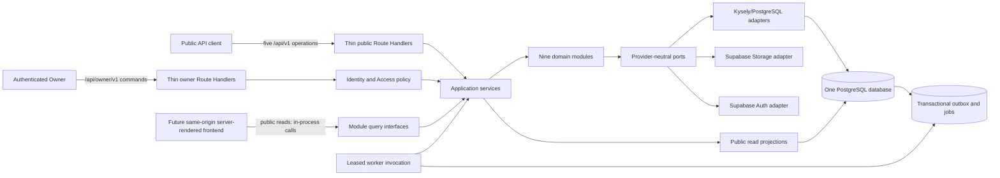
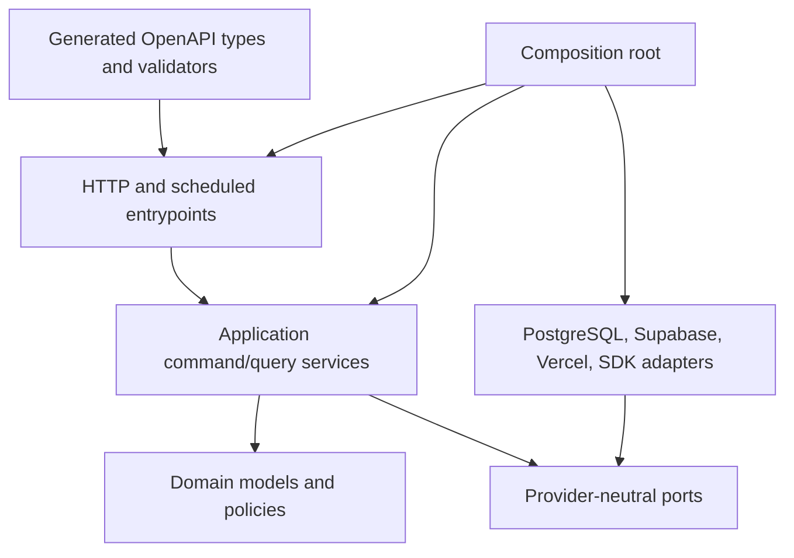
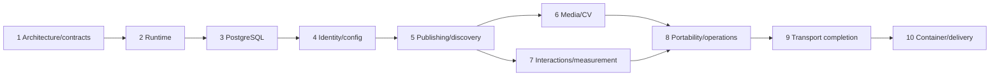

# ShipWithAli Backend Implementation Guide

Status: approved implementation blueprint; application runtime not yet implemented

## Table of contents

1. [Purpose and authority](#1-purpose-and-authority)
2. [Scope and fixed assumptions](#2-scope-and-fixed-assumptions)
3. [Target architecture](#3-target-architecture)
4. [Module boundaries](#4-module-boundaries)
5. [Shared domain contracts](#5-shared-domain-contracts)
6. [PostgreSQL design](#6-postgresql-design)
7. [HTTP contracts and adapters](#7-http-contracts-and-adapters)
8. [Security and identity](#8-security-and-identity)
9. [Testing strategy](#9-testing-strategy)
10. [GitHub review policy](#10-github-review-policy)
11. [CI, delivery, and operations](#11-ci-delivery-and-operations)
12. [Docker portability artifact](#12-docker-portability-artifact)
13. [Environment and secret inventory](#13-environment-and-secret-inventory)
14. [Gated implementation phases](#14-gated-implementation-phases)
15. [Acceptance-scenario verification](#15-acceptance-scenario-verification)
16. [Proposed implementation tree](#16-proposed-implementation-tree)
17. [Architecture diagnostic](#17-architecture-diagnostic)
18. [Completion checklist](#18-completion-checklist)
19. [Primary references](#19-primary-references)

## 1. Purpose and authority

This guide is the execution plan for the ShipWithAli backend. It is intentionally implementation-oriented: an engineer or coding agent should be able to build the backend in the stated order without making new architecture decisions. This document does not claim that the runtime, database, contracts, tests, workflows, or container already exist.

Decision authority, from highest to lowest, is:

1. accepted records in [`docs/adr/`](./adr/);
2. the vocabulary in [`CONTEXT.md`](../CONTEXT.md);
3. behavior and invariants in [`docs/domain-model.md`](./domain-model.md);
4. this implementation guide;
5. OpenAPI descriptions, generated transport artifacts, provider adapters, and code.

OpenAPI is authoritative only at an HTTP boundary. Domain interfaces remain authoritative for business behavior. Generated transport types must never become domain types.

## 2. Scope and fixed assumptions

### 2.1 Required backend stack

| Concern | Decision |
| --- | --- |
| Runtime | Node.js 24 LTS, pinned in `.nvmrc`, `package.json#engines`, CI, and Docker |
| Backend shell | Next.js App Router Route Handlers; React rendering is not part of this guide |
| Language | TypeScript with `strict`, `noUncheckedIndexedAccess`, and `exactOptionalPropertyTypes` |
| Domain shape | One domain-oriented modular monolith with nine deep modules |
| Database | One PostgreSQL database, hosted by Supabase in deployed environments |
| SQL access | Kysely behind repository adapters; reviewed SQL migrations remain the schema source of truth |
| Migrations | Timestamped SQL files under `supabase/migrations/` |
| Identity | Supabase Auth with GitHub OAuth for the sole Owner; no Visitor accounts |
| Object storage | Supabase Storage behind an object-storage port |
| Primary runtime | Vercel |
| Portable artifact | Tested multi-stage OCI image published to GHCR |
| Contracts | OpenAPI 3.1 source for public v1 and authenticated owner v1; generated TypeScript types and runtime validators |
| Errors | RFC 9457 Problem Details at HTTP boundaries |
| Async work | PostgreSQL transactional outbox and leased PostgreSQL jobs; no external broker in v1 |

Provider SDK types from Next.js, Supabase, Kysely, Vercel, or third parties may appear only in composition roots and adapter packages. They must not cross a domain or application interface.

### 2.2 Capacity and recovery envelope

These are launch assumptions, not achieved measurements:

| Measure | Planning value | Consequence |
| --- | ---: | --- |
| Page views | 100,000/month | A single database and deployment are sufficient; measure before adding infrastructure |
| Peak total requests | 25 requests/second | Size connection pools conservatively and load-test at least 2x this rate |
| Peak mutations | 5 requests/second | PostgreSQL outbox/jobs have ample headroom; no Kafka or Redis |
| Public availability | 99.9% | About 43.8 minutes/month or 8.76 hours/year of allowed unavailability |
| Relational RPO | 24 hours | Nightly database backup is mandatory |
| Media RPO | 7 days | Weekly storage/export backup is mandatory |
| RTO | 8 hours | Monthly isolated restore rehearsal must prove the runbook fits this window |

Sizing assumptions used only for initial tests are at most 100,000 raw events/month at 2 KiB each before indexes, less than 1 GiB of relational data at launch, and less than 10 GiB of media. Raw events are retained for only 14 days. Alert at 70% of any paid plan, database, connection, or storage limit and revisit the estimates after 30 days of production evidence.

### 2.3 Explicit exclusions

The backend implementation must not add:

- React pages, layouts, components, JSX, CSS, design systems, browser presentation, SEO implementation, or frontend state management;
- frontend accessibility or RTL rendering work, Core Web Vitals instrumentation, or other browser concerns;
- any first-release Lab route, command, query, navigation behavior, interaction, or owner workflow;
- microservices, Kubernetes, Redis, Kafka, GraphQL, an external search engine, automatic recommendation, or automatic translation publication;
- server stubs generated from OpenAPI or internal modules coupled to HTTP;
- a second analytics identity derived from the functional interaction identity.

Backend validation of bilingual publication rules and Media accessibility metadata is in scope. Backend records must support a future accessible English and Arabic presentation even though that presentation is excluded here.

## 3. Target architecture

### 3.1 Runtime and data flow



The future frontend remains in the same Next.js deployment. Server-rendered public reads call module query interfaces in-process, so no broad public read API is created merely to connect two parts of the same process. The five accepted public mutations/download operation remain versioned HTTP contracts. Owner automation uses the separate authenticated owner contract.

### 3.2 Dependency rules



Enforce these rules in CI:

- `domain/` imports only its module domain plus `shared/domain`.
- `application/` imports its domain, public interfaces from other modules, and `shared/domain`; it does not import another module's repository implementation.
- Cross-module commands and queries use exported application interfaces. Cross-module durable reactions use versioned Domain events.
- Only a module's persistence adapter writes its owned tables. Database foreign keys may enforce stable references, but they do not grant another module a write path.
- `adapters/` implement ports and may import provider SDKs. Domain and application code never import `next/*`, `@supabase/*`, `kysely`, Vercel packages, OpenAPI generated code, or vendor-specific types.
- Route Handlers validate transport input, construct one command/query, call one application interface, and translate the result. They contain no business decisions.
- Dependency checks fail on cycles, deep imports into another module, or provider leakage.

### 3.3 Transaction and consistency policy

Correctness-critical owner operations execute through synchronous in-process interfaces inside one PostgreSQL transaction. Publication, route changes, taxonomy merges, CV activation, and Moderation must commit domain state, public projection changes, and outbox rows atomically. Notifications, aggregates, export assembly, cache invalidation, and alerts run from the outbox and are eventually consistent.

A failed optional dependency never replaces the last valid published state. A transaction rollback emits no Domain event. An outbox delivery may happen more than once, so every handler is idempotent.

## 4. Module boundaries

Each module is deep: it owns its invariants, application interfaces, persistence contract, schema objects, tests, and emitted events. A barrel at `src/modules/<module>/index.ts` is the only import surface for another module.

| Module | Owns and enforces | Exposes | May depend synchronously on |
| --- | --- | --- | --- |
| Portfolio Configuration | Portfolio identity, public profile, Contact channels, Global project CTA, supported locales and truthful capability flags | Read settings; update profile/channels/CTA; resolve public configuration | Media acceptance query; Identity and Access policy |
| Content and Publishing | Projects, Achievements, Testimonials, lifecycle, immutable localized revisions, evidence, publication, durable route identity, redirects, Project status, Featured, curated Project relationships | Save/review/publish/hide/archive/restore; change slug/status/featured; resolve public content | Portfolio Configuration, Taxonomy and Discovery, Media; transactional ports |
| Taxonomy and Discovery | Controlled taxonomies and values, assignment rules, rename/retire/merge history, newest-published discovery projections | Taxonomy commands; validate assignments; public discovery queries | Content publication facts only through stable interfaces/events |
| Media | Media asset identity, upload candidates, safety/ownership/suitability checks, variants, accessibility metadata, explicit acceptance | Create upload intent; record processing; accept/reject asset; obtain provider-neutral delivery reference | Identity and Access; object storage and scanner ports |
| CV Portfolio | CV versions, accepted English document assets, exactly one Current CV, retained history | Register candidate; accept version; activate Current CV; stream/download current English CV | Media acceptance query; Identity and Access |
| Interaction and Moderation | Functional Visitor identity, one current Reaction and Rating per Visitor/Project, Feedback, Moderation decision history, public aggregate eligibility | Public reaction/rating/feedback commands; owner moderate command; aggregate and approved-feedback queries | Content visibility query; Identity and Access abuse/actor policy |
| Measurement | Consent record, purpose-separated measurement identity, allowlisted Public event data, immutable Analytics goal versions, daily aggregates, Low-sample state, retention | Ingest allowed event; activate goal version; report aggregate; expire/anonymize detail | Published content identity query; clock/hash ports |
| Identity and Access | Actor resolution, GitHub OAuth Owner allowlist, session verification, purpose-limited Visitor signals, authorization and rate-limit subjects | Resolve `ActorContext`; authorize owner/visitor/system operation; issue/verify pseudonymous tokens | Supabase Auth and cryptography adapters only |
| Portability and Operations | Versioned Owner exports, integrity manifests, outbox dispatch, leased jobs, retention orchestration, alerts, backup/restore evidence and health/readiness policy | Request/export/download export; claim/complete/fail jobs; operational checks | Read-only ports from every module; no direct writes to their tables |

Forbidden dependencies include Content writing Media or Taxonomy tables; Measurement reading Feedback text; Portability reconstructing provider SDK objects; and any module importing a Next.js request, Supabase user, Kysely database instance, or Vercel request type.

Extraction is not a first-release objective. Consider extracting a module only after a recorded trigger is sustained: independent team ownership, a security/isolation boundary, or measured load that cannot be addressed by indexes, connection tuning, public projections, or independent job scaling. Extraction requires a separate database and versioned event/interface boundary, never shared-table access.

## 5. Shared domain contracts

Place these contracts in `src/shared/domain/`. The syntax below is normative in meaning; exact helper names may vary only if tests preserve the semantics.

```ts
declare const stableIdBrand: unique symbol;
export type StableId<TKind extends string> = string & {
  readonly [stableIdBrand]: TKind;
};

declare const idempotencyKeyBrand: unique symbol;
export type IdempotencyKey = string & {
  readonly [idempotencyKeyBrand]: "IdempotencyKey";
};

export type ActorContext =
  | { readonly kind: "owner"; readonly ownerId: StableId<"Owner">; readonly sessionId: string }
  | { readonly kind: "visitor"; readonly functionalId?: StableId<"FunctionalVisitor">; readonly consent: "granted" | "denied" | "unknown" }
  | { readonly kind: "system"; readonly jobId: StableId<"Job">; readonly purpose: string };

export type Result<T, E extends Rejection = Rejection> =
  | { readonly ok: true; readonly value: T }
  | { readonly ok: false; readonly error: E };

export type Rejection =
  | { readonly kind: "validation"; readonly code: string; readonly details?: Readonly<Record<string, unknown>> }
  | { readonly kind: "unauthenticated"; readonly code: string }
  | { readonly kind: "forbidden"; readonly code: string }
  | { readonly kind: "not_found"; readonly code: string }
  | { readonly kind: "conflict"; readonly code: string; readonly currentVersion?: number }
  | { readonly kind: "precondition_failed"; readonly code: string; readonly currentVersion?: number }
  | { readonly kind: "rate_limited"; readonly code: string; readonly retryAfterSeconds: number }
  | { readonly kind: "temporarily_unavailable"; readonly code: string };

export interface DomainEvent<TType extends string, TPayload> {
  readonly eventId: StableId<"DomainEvent">;
  readonly eventType: TType;
  readonly schemaVersion: number;
  readonly aggregateId: StableId<string>;
  readonly aggregateVersion: number;
  readonly occurredAt: string; // RFC 3339 UTC instant supplied by Clock
  readonly correlationId: string;
  readonly causationId?: string;
  readonly payload: Readonly<TPayload>;
}
```

Semantics:

- `StableId` is an opaque, immutable UUIDv7 generated before persistence. A title, slug, URL, provider key, email, or storage path is never an identity.
- `IdempotencyKey` is an opaque client value of 1-128 visible ASCII characters. The server scopes it by operation and actor, stores a canonical request hash, and returns the original result on an exact retry. Reuse with a different hash is a `conflict` rejection.
- `ActorContext` is constructed only by an identity adapter. Domain code accepts it but never parses cookies, JWTs, IP addresses, Supabase claims, or request headers.
- `Result<T>` carries expected business rejection. Programmer defects and infrastructure faults remain exceptions at the adapter boundary, are logged with a correlation ID, and become generic Problem Details without leaking internals.
- `Rejection.code` is a stable machine code. Human detail is transport-localized and must not be used for branching.
- Domain events are immutable facts. `eventType` and `schemaVersion` are versioned independently; consumers reject unknown major semantics, ignore additive fields, and remain idempotent by `eventId`.
- Commands that update an aggregate include `expectedVersion`. A version mismatch returns `precondition_failed` and never partially changes state.

## 6. PostgreSQL design

### 6.1 Ownership and schemas

Use one PostgreSQL database and module-prefixed schemas or tables. The preferred schemas are `portfolio_config`, `content`, `taxonomy`, `media`, `cv`, `interaction`, `measurement`, `identity_access`, and `operations`. `public_read` contains read-only projections and security-barrier views intended for public server-side queries.

Every module owns its DDL and repository adapter. Cross-module references store stable IDs; use foreign keys when they do not create deployment-order cycles or transfer ownership. Kysely database types are generated or handwritten only in persistence adapters and are never exported from a module.

### 6.2 Migration policy

- Create timestamped, reviewed SQL files at `supabase/migrations/<UTC timestamp>_<description>.sql`.
- Never make schema changes directly in a deployed Supabase Dashboard.
- Each migration sets a bounded `lock_timeout`, is replayable from an empty local database, and has an explicit rollback/forward-fix note in the pull request.
- Use expand-contract: add nullable columns/tables/indexes and dual-compatible code first; backfill in bounded batches; switch reads/writes; enforce constraints; remove old structures only after at least one successful release and rollback window.
- Build large indexes with the least-blocking PostgreSQL method supported by the migration transaction strategy. Document any non-transactional migration.
- CI runs `supabase db reset`, migration tests, generated database-type drift checks, and a migration from the previous release snapshot.
- Staging receives migrations before its exact-commit deployment. Production performs a dry run, applies compatible expansion migrations, deploys and verifies code, and schedules contractions separately.

### 6.3 RLS and roles

Enable Row Level Security on every exposed table, including Storage metadata policies. Default deny is mandatory.

| Role/path | Access |
| --- | --- |
| Anonymous/public | No base-table access; read only approved `public_read` projections needed by the server path and the Current CV object policy |
| Authenticated Owner | Rows for the configured Portfolio identity, subject to owner claim/allowlist and operation policy |
| Application runtime | Least-privilege database role; module repositories still enforce ownership and never expose a general SQL handle |
| Worker | Only outbox/job and module command permissions required for its registered handlers |
| Migration | DDL only in deployment jobs; never available to the application runtime |
| Backup/restore | Separate credentials, access logged, available only to scheduled/protected workflows |

RLS tests execute with actual JWT claims/roles and prove both allowed and denied paths. Service-role credentials must not be used to make RLS tests pass.

### 6.4 Concurrency, idempotency, and public projections

- Mutable aggregate roots have `version bigint not null` and update with `where id = ? and version = ?`; a zero-row update is a concurrency rejection.
- Publication timestamps are written by the database transaction clock. Normal Project discovery orders by published timestamp descending, then stable ID descending for deterministic ties.
- Unique partial indexes enforce one Current CV, one current Rating/Reaction per functional Visitor and Project, one current published Revision per content/language, canonical route uniqueness, and other cardinality invariants.
- The idempotency ledger stores operation scope, actor scope, key, canonical request SHA-256, status, serialized safe response, and expiry. Reservation and domain mutation occur in one transaction.
- Public projections contain only already-approved, currently visible data. They are updated in the correctness transaction when visibility depends on atomicity; aggregates that tolerate lag may update from the outbox.
- Application caches may use Vercel/CDN HTTP caching for immutable or safely revalidated public reads. Cache invalidation is an outbox effect. No cache is a source of truth and Redis is excluded.

### 6.5 Outbox and leased jobs

An `operations.outbox` row includes `event_id`, `event_type`, `schema_version`, aggregate identity/version, payload, correlation metadata, `occurred_at`, `available_at`, attempt count, lease owner/expiry, completion time, and last safe error code. A unique event ID prevents duplicate publication.

Workers claim bounded batches in a short transaction using `SELECT ... FOR UPDATE SKIP LOCKED`, set a lease, commit, then run the handler outside the claim transaction. Completion uses the lease token. Expired leases are reclaimable. Retry uses capped exponential backoff plus jitter; after the configured maximum, move the item to a failed state and raise an actionable Operational alert. Handler side effects record their event ID or idempotency token.

Scheduled work uses the same job mechanism. Vercel scheduling is only a trigger adapter: it calls a protected endpoint that claims due work. The domain does not depend on Vercel scheduling types.

### 6.6 Retention and recovery

Retention jobs run at least daily and are idempotent:

- delete or irreversibly anonymize raw Public event data after 14 days;
- retain daily aggregates for 13 months, then delete them;
- delete rejected or unresolved Feedback after 90 days unless a shorter governing requirement applies;
- retain suppressed Feedback history for 12 months, then remove/anonymize eligible text while preserving a minimal audit fact if lawful;
- never use names, Feedback text, CV content, direct identifiers, or secrets as Measurement dimensions.

Nightly relational backups must satisfy the 24-hour RPO. Weekly media plus Owner-export backups must satisfy the 7-day media RPO. A monthly isolated restore measures discovery, download, restoration, integrity verification, application readiness, and total elapsed time against the 8-hour RTO.

## 7. HTTP contracts and adapters

### 7.1 Contract layout and generation

Maintain two OpenAPI 3.1 source trees:

- `openapi/public-v1/` for the accepted public surface;
- `openapi/owner-v1/` for the authenticated owner surface.

Redocly lints and bundles each contract. A pinned generator produces committed TypeScript transport types and strict runtime validators under `src/contracts/http/<surface>/generated/`. A deterministic post-generation step must ensure object validators reject unknown properties. CI regenerates into a temporary directory and fails on any diff. Generated files are never manually edited and server stubs are never generated.

All `/api/v1` and `/api/owner/v1` changes are additive and backward compatible. CI compares the bundled contract to the `master` baseline and rejects removed/renamed fields, narrower inputs, wider required sets, changed security, changed status semantics, or other breaking behavior. Breaking changes require a new major path.

### 7.2 Public v1 operations

The public contract contains exactly these operations:

| Method and path | Operation | Principal semantics |
| --- | --- | --- |
| `PUT /api/v1/projects/{projectId}/reaction` | `putProjectReaction` | Upsert one like/dislike for a permitted functional Visitor identity and Published Project |
| `PUT /api/v1/projects/{projectId}/rating` | `putProjectRating` | Upsert one integer 1-5 Rating for the same identity boundary |
| `POST /api/v1/projects/{projectId}/feedback` | `postProjectFeedback` | Store private pending Feedback after validation and abuse checks |
| `POST /api/v1/events` | `postPublicEvent` | Accept only allowlisted, privacy-minimized events after analytics consent |
| `GET /api/v1/cv/current` | `getCurrentCv` | Resolve/stream or redirect to the single accepted English Current CV |

Require `Idempotency-Key` on all four mutation paths. The reaction and rating resource semantics are also naturally idempotent. Do not add public owner CRUD, broad content reads, Lab behavior, provider endpoints, or internal module calls to this contract.

### 7.3 Owner v1 operations

The private contract is authenticated and command-oriented. It exposes intent, not table-shaped CRUD. Mutating an existing aggregate requires `If-Match` with its version and `Idempotency-Key`. Initial implementation must cover these command groups:

| Area | Required operation paths |
| --- | --- |
| Configuration | `PUT /api/owner/v1/configuration/profile`, `PUT /api/owner/v1/configuration/contact-channels`, `PUT /api/owner/v1/configuration/project-cta` |
| Revisions/publication | `POST /api/owner/v1/content/{contentId}/revisions`, `POST /api/owner/v1/content/{contentId}/commands/publish-language`, `/commands/hide`, `/commands/archive`, `/commands/restore` |
| Project intent | `POST /api/owner/v1/projects/{projectId}/commands/change-status`, `/commands/set-featured`, `/commands/change-slug`, `/commands/relate-project` |
| Taxonomy | `POST /api/owner/v1/taxonomies/{taxonomyId}/values`, `POST /api/owner/v1/taxonomy-values/{valueId}/commands/rename`, `/commands/retire`, `/commands/merge`, and `POST /api/owner/v1/projects/{projectId}/commands/assign-taxonomy-value` |
| Media | `POST /api/owner/v1/media/upload-intents`, `POST /api/owner/v1/media/{mediaId}/commands/record-processing`, `/commands/accept`, `/commands/reject` |
| CV | `POST /api/owner/v1/cv/versions`, `POST /api/owner/v1/cv/versions/{versionId}/commands/accept`, `/commands/activate` |
| Moderation | `POST /api/owner/v1/feedback/{feedbackId}/commands/approve`, `/commands/reject`, `/commands/suppress` |
| Measurement | `POST /api/owner/v1/analytics-goals/{goalId}/versions`, `POST /api/owner/v1/analytics-goals/{goalId}/commands/activate-version` |
| Portability | `POST /api/owner/v1/exports`, `GET /api/owner/v1/exports/{exportId}`, `GET /api/owner/v1/exports/{exportId}/download` |

Add narrow authenticated owner queries needed to inspect histories and verify outcomes: `GET /api/owner/v1/content/{contentId}`, `/projects/{projectId}`, `/taxonomies/{taxonomyId}`, `/media/{mediaId}`, `/cv`, `/feedback/{feedbackId}`, and `/analytics-goals/{goalId}`. These are aggregate/application views, not raw table mirrors. Do not create a generic patch endpoint.

Owner authentication uses a verified Supabase session originating from GitHub OAuth plus an explicit configured Owner allowlist. Authentication alone is not authorization. The contract declares its security scheme globally and documents `401` versus `403`.

### 7.4 Problem Details mapping

Every non-success response uses `application/problem+json` and RFC 9457 fields `type`, `title`, `status`, `detail`, and `instance`, plus safe extensions `code`, `traceId`, and field errors when applicable.

| Domain/adapter condition | HTTP status |
| --- | ---: |
| Malformed transport input | 400 |
| Missing/invalid authentication | 401 |
| Authenticated but unauthorized | 403 |
| Unknown resource | 404 |
| Idempotency-key reuse, slug/identity conflict, invalid transition | 409 |
| Optimistic concurrency or `If-Match` failure | 412 |
| Valid shape but failed publication/evidence/domain validation | 422 |
| Rate limit/abuse protection | 429 with `Retry-After` |
| Temporary dependency or readiness failure | 503 |
| Unexpected failure | 500 with no stack, SQL, token, provider payload, or secret |

The adapter maps typed `Rejection` exhaustively. Contract tests must fail when a new rejection kind lacks a mapping.

## 8. Security and identity

- Accept the Owner only when the verified Supabase user is in the configured GitHub-linked Owner allowlist. Disable password and public signup flows unless a later ADR permits them.
- Validate issuer, audience, expiry, signature, and required claims. Rotate secrets without changing `ActorContext`.
- Use separate pseudonymous values for functional interaction deduplication and consented analytics. Hash with separate rotating server-side keys and never join the two purposes.
- Set secure, HTTP-only, same-site cookies for server sessions. Enforce same-origin/CSRF protection for cookie-authenticated owner mutations.
- Validate content type, declared and detected file type, size, malware/safety result, ownership/suitability record, and accessibility metadata before Media/CV acceptance. Uploaded objects stay private until accepted.
- Use allowlists for event names, event properties, MIME types, redirect targets, external-link protocols, job types, and outbox handlers.
- Apply rate limits and abuse controls at the adapter edge; fail closed for owner commands and fail safely for optional Measurement intake without blocking the Core public journey.
- Sanitize logs. Never log JWTs, OAuth tokens, cookies, raw visitor identifiers, Feedback text, CV content, object signed URLs, database URLs, or TestSprite credentials.
- Scan dependencies, SQL migrations, container layers, SBOMs, and the deployed API. Block release on unresolved critical/high findings unless an explicitly documented human-approved exception has an expiry.

## 9. Testing strategy

### 9.1 Repository-owned deterministic tests

These tests are mandatory and remain authoritative even when TestSprite is available.

| Layer | Required coverage |
| --- | --- |
| Unit | Vitest through module interfaces; invariants, state transitions, rejection codes, event payload/version, privacy rules, clocks/IDs, and all 16 acceptance scenarios at the owning module boundary |
| PostgreSQL integration | Real local Supabase/PostgreSQL; migrations from empty and prior release; RLS allow/deny; transaction rollback; optimistic concurrency; unique constraints; idempotency replay/conflict; outbox atomicity; `SKIP LOCKED` lease exclusion/reclaim; retention and projection behavior |
| Contract | Redocly lint/bundle; generation; strict validator behavior; committed-artifact drift; public and owner compatibility against `master`; examples validated against schemas |
| HTTP adapters | Request/header/auth parsing, one-interface dispatch, complete Problem Details mapping, response headers, idempotency, and absence of provider/domain leakage |
| Container | Build with no secrets, run as non-root, `/livez`, `/readyz`, SIGTERM drain, failed readiness with unavailable database, and OCI label inspection |
| Security | Dependency/secret/SAST scans, RLS negative cases, auth/CSRF, abuse/rate-limit, upload validation, log-redaction, and vulnerability scan of the image |
| Load/resilience | At least 50 requests/second reads and 10 mutations/second for a sustained test; outbox backlog/recovery; analytics/storage/link failure injection; last-valid publication remains available |
| Backup/restore | Database and storage/export backup creation, checksum/manifest verification, isolated restore, Current CV/public projection validation, and measured RPO/RTO evidence |

Use deterministic factories, a fixed test clock, seeded IDs, and non-production data. Parallel tests receive isolated schemas or databases. A passing test must not depend on execution order, the public internet, production credentials, or an existing developer database.

### 9.2 TestSprite deployed backend layer

TestSprite complements rather than replaces repository tests. Create one backend API project for the isolated staging environment; frontend projects are deferred.

Coverage is generated and reviewed from:

1. the bundled public v1 OpenAPI contract;
2. the bundled authenticated owner v1 OpenAPI contract;
3. the 16 acceptance scenarios in this guide and `docs/domain-model.md`;
4. security, failure-injection, and idempotency workflows that span multiple operations.

Use deterministic non-production records with a unique run prefix and a cleanup job. Use a dedicated test Owner account and least-privilege test credentials. Never point TestSprite at production or reuse the human Owner's session.

CI requirements:

- store `TESTSPRITE_API_KEY` as a GitHub Actions secret;
- store the TestSprite project ID as the `TESTSPRITE_PROJECT_ID` GitHub Actions variable;
- pin `@testsprite/testsprite-cli` to an exact version in the lockfile or pin `TestSprite/testsprite-action` to a reviewed full commit SHA; do not use `latest` or a floating `@v1` in the release gate;
- invoke the full project with an explicit project ID, wait for a terminal verdict, set a finite timeout, and use the process exit code as the gate;
- treat skipped, cancelled, timed-out, partial, or unavailable runs as failures;
- upload JUnit XML, machine-readable summary JSON, and a human job summary even on failure;
- run the full backend suite for every release candidate and nightly; a failure or TestSprite outage blocks production promotion but does not block local development.

TestSprite must exercise only deployed, contracted behavior. Scenarios whose public read is intentionally in-process are asserted through the command outcome plus narrow owner state/history queries, while repository integration tests prove the corresponding public projection. Do not create test-only production endpoints.

## 10. GitHub review policy

Codex is the sole AI pull-request reviewer. Human approval and deterministic CI remain separate required branch-protection conditions; an AI approval can satisfy neither.

Implementation steps:

1. Install/authorize Codex for this repository and enable automatic review for every non-draft pull request targeting `master`.
2. Add a dedicated `Pull request review` section to the root `AGENTS.md`. It must instruct Codex to review domain invariants, illegal module dependencies, provider-type leakage, authorization/RLS, secrets and privacy, SQL/migration safety, OpenAPI compatibility, generated drift, adequate negative tests, operational rollback, and backend-only scope.
3. Require a fresh Codex review whenever substantive code, contracts, migrations, auth, CI, or test behavior changes after the prior review.
4. Resolve each actionable finding in code or record an explicit human-reviewed rationale in the pull request. Do not silently dismiss findings.
5. Configure branch protection for `master` to require deterministic CI, the current Codex review/check, and at least one human approval. Dismiss stale reviews after substantive pushes.

CodeRabbit must not be added. During the first implementation pull request, search the repository and GitHub settings for CodeRabbit configuration, workflow jobs, secrets, GitHub App installation/requirement, and branch-protection checks. Remove each discovered item and record evidence. If repository permissions prevent removal, block completion with a named owner/action; do not leave CodeRabbit as a second AI reviewer.

## 11. CI, delivery, and operations

### 11.1 Workflow matrix

| Trigger | Required sequence | Promotion rule and evidence |
| --- | --- | --- |
| Pull request to `master` | Locked install; lint; strict typecheck; architecture/dependency checks; public and owner OpenAPI lint/bundle/generate/drift/compatibility; Vitest unit tests; local Supabase start/reset plus migration/RLS/integration tests; Next.js build; Docker build; container smoke/health/shutdown test; SBOM; vulnerability scan | All checks green, current Codex review, actionable findings resolved/documented, and human approval |
| Merge to `master` | Apply reviewed migrations to a separate staging Supabase project; deploy the exact commit to staging Vercel; run smoke, security, failure-injection, and blocking full TestSprite backend suite | Produces an immutable release-candidate record containing commit, migration set, Vercel deployment URL/ID, TestSprite run, and evidence artifacts |
| Production release | Protected GitHub environment and human approval; migration history check and dry-run; apply expand-compatible production migrations; build/deploy the approved exact commit to Vercel with production settings but no domain assignment; run readiness, smoke, security checks, and full TestSprite gates; promote that staged deployment only on success | Any failed or unavailable gate prevents domain promotion. Record deployment ID, commit, migration versions, checks, approver, and rollback target |
| GHCR publication | Build the same approved commit, attach OCI labels, produce SBOM, scan, push immutable `sha-<full commit>` and release tags, generate provenance/SBOM attestations, verify digest and attestation | Never rebuild a different commit under the release tag; mutable convenience tags are optional and never deployment evidence |
| Nightly | Database backup and full TestSprite backend run; retention/outbox health checks | Failure raises an actionable Operational alert and opens/updates a tracked issue |
| Weekly | Supabase Storage plus Owner-export backup, manifest and checksum validation | Evidence includes object counts, bytes, manifest version, encryption/location, and failures |
| Monthly | Restore the selected relational and media/export backups into an isolated environment and run integrity/smoke scenarios | Must demonstrate relational RPO 24h, media RPO 7d, and RTO 8h; failure blocks the next production release |

Use pinned action commit SHAs for security-sensitive and release workflows. Grant each job the minimum GitHub token permissions. Production secrets exist only in the protected production environment and are never exposed to pull requests.

### 11.2 Staging and production behavior

Staging uses its own Supabase project, Vercel environment, OAuth application/redirect, storage buckets, keys, TestSprite project, and deterministic test data. It must not share production data or credentials.

Disable automatic production-domain assignment. Create a staged production deployment for the exact approved commit, test the deployment URL, and promote the same deployment without rebuilding only after all gates pass. Rollback reassigns the previous verified deployment, but any non-backward-compatible database contraction requires its documented forward fix; this is why expand-contract is mandatory.

### 11.3 Observability and operational thresholds

Emit structured JSON logs, metrics, and trace/correlation IDs at adapters. Minimum signals are request count/latency/status, database pool usage, transaction errors, RLS denials, outbox age/depth/retries/dead items, job lease age, publication failures by safe code, event accept/drop counts, retention results, backup age, restore duration, storage failures, and readiness state.

Alert only on actionable conditions: sustained availability/error-budget burn, authentication anomalies, publication correctness failures, oldest outbox item over 15 minutes, failed/dead jobs, retention failure, backup older than its RPO, restore rehearsal failure, database/storage thresholds over 70%, or staging/production gate failure. Routine success is dashboard evidence, not an alert.

## 12. Docker portability artifact

The Docker artifact proves portability and supplies a recoverable runtime option; Vercel remains primary.

- Set `output: "standalone"` in `next.config.ts`.
- Use a multi-stage Dockerfile pinned to a Node 24 LTS base by digest: dependency, build, and minimal runtime stages.
- Copy only `.next/standalone`, `.next/static`, required public/server assets, and runtime metadata into the final image.
- Create and run as an unprivileged user; use a read-only root filesystem where the target runtime permits it and write temporary data only to an explicit temp directory.
- Use `.dockerignore` to exclude Git data, local env files, tests, reports, caches, Supabase local volumes, and documentation not needed at runtime.
- Pass no secrets as build arguments or image environment defaults. Inject runtime configuration at container start.
- Add `GET /livez` for process liveness and `GET /readyz` for required dependency/configuration readiness. Neither endpoint returns secret or provider detail.
- On `SIGTERM`, stop accepting work, stop claiming jobs, finish or release current leases within a bounded grace period, close database pools, and exit non-zero if shutdown cannot complete safely.
- Apply OCI source, revision, version, created, title, description, and license labels. Tag by immutable commit/release and retain the digest.
- Generate an SPDX or CycloneDX SBOM, run a vulnerability scan, create GitHub provenance and SBOM attestations, push to GHCR, and verify the attestation by digest.

Local Supabase is started with the pinned Supabase CLI, not embedded into the application image. An optional Compose profile may run the application container against that local stack; it must reuse runtime environment injection and must not become a second production topology.

## 13. Environment and secret inventory

Names are normative unless a provider forces a different name. Commit only `.env.example` with empty/documented placeholders.

| Name | Secret? | Scope | Purpose |
| --- | --- | --- | --- |
| `NODE_ENV` | No | All | Runtime mode |
| `APP_BASE_URL` | No | Per environment | Canonical same-origin URL |
| `DATABASE_URL` | Yes | App/worker | Least-privilege pooled PostgreSQL connection |
| `DATABASE_DIRECT_URL` | Yes | Migration/backup only | Direct PostgreSQL connection; never app runtime |
| `SUPABASE_URL` | No | Per environment | Supabase project endpoint |
| `SUPABASE_ANON_KEY` | No, but controlled | App | Public Supabase client capability; still limited by RLS |
| `SUPABASE_SERVICE_ROLE_KEY` | Yes | Narrow server adapters only | Privileged Auth/Storage action; forbidden in browser/test logs |
| `SUPABASE_ACCESS_TOKEN` | Yes | Deployment workflow | Supabase CLI authentication |
| `SUPABASE_PROJECT_ID` | No | GitHub variable per environment | Migration target identity |
| `SUPABASE_DB_PASSWORD` | Yes | Deployment workflow | Remote migration authentication |
| `GITHUB_OAUTH_CLIENT_ID` | No | Auth environment | Owner GitHub OAuth app |
| `GITHUB_OAUTH_CLIENT_SECRET` | Yes | Auth environment | Owner GitHub OAuth app secret |
| `OWNER_GITHUB_SUBJECTS` | Sensitive config | App | Explicit allowlist of Owner GitHub identities |
| `FUNCTIONAL_ID_HASH_KEY` | Yes | App | Purpose-limited interaction identity |
| `MEASUREMENT_ID_HASH_KEY` | Yes | App | Separate consented Measurement identity |
| `CRON_TRIGGER_SECRET` | Yes | Scheduler/worker | Authenticates scheduled job trigger |
| `VERCEL_TOKEN` | Yes | Deployment workflow | Vercel CLI deployment/promotion |
| `VERCEL_ORG_ID` / `VERCEL_PROJECT_ID` | No | GitHub variables | Exact Vercel target |
| `TESTSPRITE_API_KEY` | Yes | Staging/release/nightly | Dedicated TestSprite CI authentication |
| `TESTSPRITE_PROJECT_ID` | No | GitHub variable | Backend TestSprite project selection |
| `BACKUP_ENCRYPTION_KEY` | Yes | Backup workflow | Encrypt backup artifacts outside primary provider |
| `GHCR_IMAGE` | No | Workflow | `ghcr.io/<owner>/<repository>` image name |
| `GITHUB_TOKEN` | Ephemeral | Workflow | GHCR push and attestations with minimal permissions |

Validate configuration at process startup with a handwritten provider-neutral configuration schema. Fail readiness on missing required runtime configuration, but never print secret values. Maintain separate development, CI, staging, and production values.

## 14. Gated implementation phases

No phase is complete until its exit criteria and evidence are committed or attached to CI. Later work may begin experimentally, but it cannot merge past an unmet dependency gate.

### Phase 1: Architecture alignment and contracts

**Dependencies:** accepted ADRs, `CONTEXT.md`, and `docs/domain-model.md`.

**Tasks:** establish Node/TypeScript/package manager pins; add module skeletons and architecture dependency rules; define shared domain contracts; restore/create the public v1 OpenAPI source without changing its five-operation boundary; design owner v1; configure Redocly, pinned type/validator generation, strictification, drift and compatibility checks; add the `AGENTS.md` Codex review policy; inventory and remove/plan removal of CodeRabbit.

**Exit criteria:** both contracts lint/bundle; generated artifacts reproduce byte-for-byte; compatibility baseline exists; illegal import fixture fails the architecture check; no module imports a provider SDK; no Lab or frontend surface appears.

**Evidence:** contract bundles, generation-diff log, architecture report, route inventory, dependency/version manifest, CodeRabbit removal checklist, and reviewed Codex instructions.

### Phase 2: Runtime foundation

**Dependencies:** Phase 1.

**Tasks:** initialize backend-only Next.js App Router shell; strict TS/Vitest/linting; configuration validation; composition root; correlation/logging/error boundary; clock/ID/transaction ports; `/livez` and `/readyz`; graceful shutdown; empty Route Handler adapters driven by generated validators and fake application interfaces.

**Exit criteria:** production build passes; health semantics are tested; startup rejects invalid configuration; expected rejections map exhaustively to Problem Details; provider types are confined to adapters.

**Evidence:** build/typecheck/lint logs, adapter tests, configuration negative tests, health and shutdown transcripts, and architecture check.

### Phase 3: PostgreSQL foundation

**Dependencies:** Phase 2.

**Tasks:** pin Supabase CLI; create local config and timestamped reviewed SQL migrations; define schemas/roles/RLS; Kysely adapter and transaction runner; optimistic version pattern; idempotency ledger; outbox and leased jobs using `FOR UPDATE SKIP LOCKED`; migration/type drift tools; deterministic seed factories.

**Exit criteria:** empty reset succeeds; prior-snapshot upgrade succeeds; RLS default-deny and allow cases pass; concurrent claims never double-own a lease; expired leases recover; state plus outbox is atomic; idempotency replay/conflict works.

**Evidence:** migration log, schema/type diff, RLS matrix, concurrency test results, transaction rollback proof, and query plans for claim/public-read paths.

### Phase 4: Identity and configuration

**Dependencies:** Phases 2-3.

**Tasks:** implement Supabase Auth adapter with GitHub OAuth Owner allowlist; `ActorContext`; separate functional and Measurement identity adapters; authorization/CSRF policies; Portfolio Configuration aggregate, repositories, owner commands and read query; audit events.

**Exit criteria:** invalid/expired/wrong-audience sessions fail; authenticated non-owner is forbidden; Owner configuration mutations are versioned/idempotent; purpose-separated IDs cannot be joined; Contact channel and CTA invariants pass.

**Evidence:** auth/RLS tests, negative authorization tests, secret/log redaction test, configuration contract tests, and audit event examples.

### Phase 5: Publishing, routes, and discovery

**Dependencies:** Phases 3-4.

**Tasks:** implement Content and Publishing plus Taxonomy and Discovery; immutable language revisions; evidence validation; lifecycle; durable route identities/redirects; status/Featured; curated relationships; taxonomy rename/retire/merge; newest-published projection; owner commands and narrow queries.

**Exit criteria:** scenarios 1-8 and applicable parts of 12-15 pass; failed publication changes no public state; redirects preserve identity; taxonomy history is auditable; no Lab command/query/route exists.

**Evidence:** unit and PostgreSQL scenario results, atomic publication test, projection query plan/order test, owner contract adapter tests, and Lab-surface search report.

### Phase 6: Media and CV

**Dependencies:** Phases 4-5.

**Tasks:** implement private upload intents, scanner/processor/object-storage ports, accessibility metadata, acceptance workflow, stable provider-neutral delivery references; implement CV version acceptance and atomic Current CV activation; public Current CV Route Handler.

**Exit criteria:** unsafe/unaccepted/inaccessible assets cannot publish; two Current CV rows are impossible; old versions remain in history; English-only v1 rule is enforced; storage outage does not corrupt published state.

**Evidence:** upload negative tests, storage adapter contract tests, scenarios 9, 12, and 13, RLS/object policy tests, and public CV HTTP tests.

### Phase 7: Interactions and measurement

**Dependencies:** Phases 4-5.

**Tasks:** implement reaction/rating upsert, Feedback submission and Moderation history, public aggregates, consent gate, event allowlist, analytics goals/versions, daily aggregates, Low-sample policy, privacy filters, and retention jobs; expose four public mutation Route Handlers.

**Exit criteria:** one current interaction per Visitor/Project; hidden/archived content rejects new interactions and disappears from projections; pending/rejected/suppressed Feedback privacy holds; denied/unknown consent stores no non-essential event; retention cutoffs pass with a fixed clock.

**Evidence:** scenarios 5, 10, 11, and 15 tests; public HTTP tests; privacy dimension audit; lease/idempotency results; retention before/after dataset.

### Phase 8: Portability and operations

**Dependencies:** Phases 3-7.

**Tasks:** implement versioned Owner export, portable schemas and integrity manifest; outbox handlers, retries/dead state, alerts, operational dashboards; backup scripts and restore runbook; scheduled retention/export/aggregate jobs.

**Exit criteria:** a compatible test importer reconstructs stable identities and histories without provider types; optional-handler failure cannot roll back committed publication; dead job alerts are actionable; isolated restore is automated enough for rehearsal.

**Evidence:** scenario 16 round-trip test, export schema/examples/checksums, outbox retry test, dashboard/alert inventory, backup artifacts, and rehearsal runbook.

### Phase 9: Transport completion

**Dependencies:** Phases 4-8.

**Tasks:** connect all public and owner handlers to real application interfaces; finish Problem Details; auth/rate-limit/idempotency headers; contract examples; HTTP adapter suites; staging seed/cleanup tooling; create and review TestSprite backend project and workflows from both contracts and 16 scenarios.

**Exit criteria:** every OpenAPI operation has a tested handler and every handler is in OpenAPI; no business rule lives in a handler; compatibility/drift gates pass; TestSprite completes with no skipped/partial tests and publishes JUnit/summary artifacts.

**Evidence:** route-to-operation matrix, coverage report, bundled contracts, generated drift result, staging TestSprite run URL/artifacts, and failure-mode run.

### Phase 10: Containerization and delivery

**Dependencies:** Phases 1-9.

**Tasks:** create standalone multi-stage Docker image, non-root runtime, ignore file, health/shutdown behavior and optional local Compose profile; implement PR/staging/production/nightly/weekly/monthly workflows; protected environments; staged Vercel promotion; GHCR immutable tags, SBOM, scan and attestations; configure branch protection and automatic Codex review; finish CodeRabbit removal.

**Exit criteria:** the complete PR gate passes; exact commit deploys to isolated staging; TestSprite blocks a deliberately failing release candidate; staged production deployment can be tested before domain assignment; GHCR digest and attestations verify; restore rehearsal meets RPO/RTO; branch protection requires CI, Codex, and human approval with no CodeRabbit requirement.

**Evidence:** workflow run links, Vercel deployment/promotion IDs, image digest/tags/labels, SBOM and vulnerability report, attestation verification, branch-protection screenshot/export, Codex review example, CodeRabbit absence evidence, backup/restore timing, and rollback drill.

### 14.1 Phase dependency/build order



## 15. Acceptance-scenario verification

The scenario number and wording remain anchored in `docs/domain-model.md`. The listed evidence is the minimum; tests may cover a scenario at more than one layer.

| # | Scenario | Required verification |
| ---: | --- | --- |
| 1 | Independent languages | Unit plus transactional integration: publish reviewed English while Arabic stays Draft; owner state and public projection contain English only |
| 2 | No text fallback | Query-interface integration: Arabic lookup returns not found/unavailable and never English text; TestSprite verifies owner publication state |
| 3 | Last valid publication | Save a new Draft after publication and prove the prior revision remains in `public_read` |
| 4 | Durable identity | Change slug with expected version; old route resolves a redirect to the new canonical route and stable Project ID is unchanged |
| 5 | Lifecycle retention | Hide/archive and prove discovery, controls, aggregates, and public approved Feedback disappear while Owner history remains |
| 6 | Orthogonal featuring | Set Featured on Draft/Hidden; public projection remains absent |
| 7 | Newest-first discovery | Seed tied and distinct publication times; assert descending time plus stable-ID tie breaker and no manual rank field |
| 8 | Controlled taxonomy | Retire blocks new assignment without deleting history; merge migrates assignments and retains mapping in one transaction |
| 9 | Atomic CV replacement | Concurrent activation test plus unique constraint proves exactly one Current CV and prior version history remains |
| 10 | Interaction deduplication | Repeat/change reaction and rating with same functional ID; current row updates and aggregate counts one; retry returns recorded response |
| 11 | Moderation privacy | Pending/rejected never enter public projection; approved can; suppression removes display and preserves eligible decision history |
| 12 | Publication gates | Table-driven unsafe media, missing metadata, unsupported claim, placeholder, and unreviewed locale failures leave last-valid state unchanged |
| 13 | Arabic boundary | Arabic publication may reference accepted English media; backend capability flags withhold English-only CV/link as localized capabilities |
| 14 | Deferred Lab | Architecture/search/contract tests prove no Lab routes, operations, repositories, projections, or owner workflow is compiled for v1 |
| 15 | Degraded dependencies | Failure injection for Measurement, alerts, storage delivery, and external links proves public core queries use last-valid content and remain ready where safe |
| 16 | Portable meaning | Export/import round trip reconstructs IDs, locales, revisions, publication pointers, lifecycle, taxonomy mappings, and Moderation history without provider fields |

## 16. Proposed implementation tree

```text
.
|-- .dockerignore
|-- .env.example
|-- .github/
|   |-- workflows/
|   |   |-- pull-request.yml
|   |   |-- staging.yml
|   |   |-- production.yml
|   |   |-- nightly.yml
|   |   |-- weekly-backup.yml
|   |   `-- monthly-restore.yml
|   `-- dependabot.yml
|-- AGENTS.md                         # add Codex pull-request review policy
|-- Dockerfile
|-- compose.yaml                      # optional app profile; Supabase CLI stays external
|-- next.config.ts                    # output: "standalone"
|-- openapi/
|   |-- public-v1/
|   |-- owner-v1/
|   `-- generated/
|       |-- public-v1.json
|       `-- owner-v1.json
|-- scripts/
|   |-- architecture-check.mjs
|   |-- check-contract-drift.mjs
|   |-- check-contract-compatibility.mjs
|   |-- strictify-generated-validators.mjs
|   |-- backup/
|   `-- restore/
|-- src/
|   |-- app/
|   |   |-- api/v1/.../route.ts
|   |   |-- api/owner/v1/.../route.ts
|   |   |-- internal/jobs/route.ts
|   |   |-- livez/route.ts
|   |   `-- readyz/route.ts
|   |-- bootstrap/
|   |   |-- composition-root.ts
|   |   `-- configuration.ts
|   |-- contracts/http/
|   |   |-- public-v1/generated/
|   |   `-- owner-v1/generated/
|   |-- modules/
|   |   |-- portfolio-configuration/{domain,application,ports,adapters}/
|   |   |-- content-publishing/{domain,application,ports,adapters}/
|   |   |-- taxonomy-discovery/{domain,application,ports,adapters}/
|   |   |-- media/{domain,application,ports,adapters}/
|   |   |-- cv-portfolio/{domain,application,ports,adapters}/
|   |   |-- interaction-moderation/{domain,application,ports,adapters}/
|   |   |-- measurement/{domain,application,ports,adapters}/
|   |   |-- identity-access/{domain,application,ports,adapters}/
|   |   `-- portability-operations/{domain,application,ports,adapters}/
|   `-- shared/
|       |-- domain/
|       |-- application/
|       `-- adapters/
|-- supabase/
|   |-- config.toml
|   |-- migrations/
|   `-- seed.sql
|-- tests/
|   |-- architecture/
|   |-- contracts/
|   |-- integration/
|   |-- http/
|   |-- load/
|   |-- security/
|   |-- container/
|   |-- backup-restore/
|   `-- fixtures/
|-- package-lock.json
|-- package.json
|-- redocly.yaml
`-- tsconfig.json
```

Curly-brace directories in this illustration mean four real directories per module, not a literal brace-named folder. Each module also has an `index.ts` public surface and colocated unit tests.

## 17. Architecture diagnostic

The planned design scores **10/10** under the system-design diagnostic. This is a design score, not runtime evidence. Runtime conformance remains unverified until the implementation phases and gates above pass.

| Diagnostic | Planned evidence | Design result |
| --- | --- | --- |
| Functional/non-functional requirements | Scope, exclusions, availability, RPO/RTO, domain scenarios | Pass |
| QPS and storage estimate | 25 peak requests/s, 5 peak mutations/s, event/relational/media envelope | Pass |
| Redundancy | Managed Vercel/Supabase deployment, backups, portable GHCR artifact, restore path | Pass, provider configuration to verify |
| Database scaling strategy | Single PostgreSQL first; indexes/projections/pooling, then replicas/provider scaling; extraction only on evidence | Pass |
| Read-heavy cache strategy | Public projections and safe HTTP/Vercel revalidation; no correctness dependency or Redis | Pass |
| Async queue strategy | Transactional outbox plus leased PostgreSQL jobs and retry/dead state | Pass |
| Monitoring and alerting | Structured telemetry, thresholds, error budget and actionable alerts | Pass |
| Deployment strategy | Staging exact commit, staged production without domain assignment, gated promotion/rollback, immutable GHCR artifact | Pass |

The first likely bottlenecks are database connections in serverless execution, unoptimized public discovery queries, Media processing duration, and outbox backlog. Measure them before changing topology. Do not interpret the 10/10 planned score as proof of availability, performance, recovery, RLS safety, or deployment correctness.

## 18. Completion checklist

Before declaring the backend implemented, verify all of the following:

- [ ] All ten phase gates have committed or linked evidence.
- [ ] All nine modules expose only provider-neutral interfaces and own their write paths.
- [ ] The public contract contains exactly the five accepted operations; owner v1 is authenticated and command-oriented.
- [ ] Both contracts lint, bundle, generate, stay in sync, and pass compatibility checks.
- [ ] RFC 9457 Problem Details mapping is exhaustive and leak-free.
- [ ] All 16 domain scenarios pass at the stated deterministic layers.
- [ ] RLS, migrations, transactions, idempotency, outbox, leases, retention, backup, and restore tests pass against PostgreSQL.
- [ ] TestSprite passes the full backend project against isolated staging with no skipped/partial result and publishes JUnit/summary artifacts.
- [ ] Codex is the only AI reviewer; automatic non-draft `master` review, fresh-review policy, human approval, and deterministic CI are enforced.
- [ ] CodeRabbit configuration, jobs, secrets, app requirement, and branch-protection check are absent or their removal is an explicitly blocking administrative action.
- [ ] PR, staging, production, GHCR, nightly, weekly, and monthly workflows behave as specified.
- [ ] The Vercel production deployment is promoted only after smoke and TestSprite gates pass.
- [ ] The GHCR image is non-root, standalone, healthy, graceful, scanned, immutable, labeled, and attested.
- [ ] Latest recovery evidence meets relational RPO 24h, media RPO 7d, and RTO 8h.
- [ ] Repository search finds no first-release Lab surface and no frontend implementation added by backend work.
- [ ] The architecture diagnostic is re-scored using runtime evidence; any failed row becomes release-blocking work rather than a paper pass.

## 19. Primary references

- [Node.js release schedule](https://nodejs.org/en/about/previous-releases)
- [Next.js Docker standalone output](https://nextjs.org/docs/app/getting-started/deploying#docker)
- [Kysely documentation](https://www.kysely.dev/)
- [Supabase local development and migration workflow](https://supabase.com/docs/guides/local-development/cli-workflows)
- [Supabase database migrations](https://supabase.com/docs/guides/deployment/database-migrations)
- [Supabase Row Level Security](https://supabase.com/docs/guides/database/postgres/row-level-security)
- [OpenAPI 3.1 specification](https://spec.openapis.org/oas/v3.1.0)
- [RFC 9457: Problem Details for HTTP APIs](https://www.rfc-editor.org/rfc/rfc9457)
- [TestSprite CLI and CI reference](https://github.com/TestSprite/testsprite-cli/blob/main/DOCUMENTATION.md)
- [TestSprite CI/CD pipeline testing](https://www.testsprite.com/use-cases/en/cli-cicd-pipeline-testing)
- [Vercel staged deployments and promotion](https://vercel.com/docs/deployments/promoting-a-deployment)
- [GitHub Container Registry](https://docs.github.com/en/packages/working-with-a-github-packages-registry/working-with-the-container-registry)
- [GitHub artifact and SBOM attestations](https://docs.github.com/en/actions/how-tos/secure-your-work/use-artifact-attestations/use-artifact-attestations)
- [OpenAI Codex automatic pull-request review](https://openai.com/index/introducing-upgrades-to-codex/)
